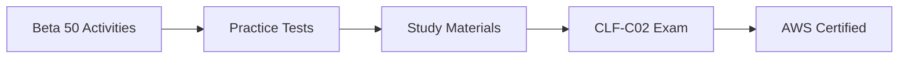

<div align="center">

# 🎓 Beta 50 Batch Program 🚀


### 🌟 *AWS Cloud Practitioner CLF-C02 Preparation Program* 🌟


</div>

---

## 📖 Program Overview

Welcome to the **Beta 50 Batch** - an intensive AWS Cloud Practitioner certification preparation program! This program includes 20 mandatory pre-session activities designed to build your cloud foundation.

**Program Duration:** 8 Weeks  
**Target Certification:** AWS Certified Cloud Practitioner (CLF-C02)  
**Activity Deadline:** Monday, November 10, 2025

---

## 📋 Pre-Session Activities Guide

### 🎯 Activity Categories

| Category | Activities | Service Focus | Guide Location |
|----------|------------|---------------|----------------|
| **Foundation** | 1-2 | Account Setup, IAM | [IAM Guides](../IAM/Guides/) |
| **Storage** | 3-4 | S3 Bucket, Static Hosting | [S3 Guides](../S3/Guides/) |
| **AI Assistant** | 5 | Amazon Q | [General Guides](../General-Guides/) |
| **Monitoring** | 6 | Billing, CloudWatch | [CloudWatch Guides](../CloudWatch/Guides/) |
| **Compute** | 7-12 | EC2, EBS | [EC2 Guides](../EC2/Guides/) |
| **Database** | 13-14 | RDS | [RDS Guides](../RDS/Guides/) |
| **Serverless** | 15 | Lambda | [Lambda Guides](../Lambda/Guides/) |
| **Messaging** | 16 | SNS | [SNS Guides](../SNS/Guides/) |
| **Infrastructure** | 17-18 | CloudFormation | [CloudFormation Guides](../CloudFormation/Guides/) |
| **Support** | 19 | Trusted Advisor | [Support Guides](../Support/Guides/) |
| **Cleanup** | 20 | Resource Management | [General Guides](../General-Guides/) |

---

## 📚 Activity List & Locations

### 🏗️ Foundation Activities (1-2)
- **Activity 1:** [AWS Console Account Setup](../IAM/Guides/aws-account-setup-guide.md)
- **Activity 2:** [IAM User & MFA Setup](../IAM/Guides/iam-user-mfa-setup-guide.md)

### 💾 Storage Activities (3-4)
- **Activity 3:** [S3 Bucket Creation](../S3/Guides/s3-bucket-creation-guide.md)
- **Activity 4:** [S3 Static Website Hosting](../S3/Guides/static-website-hosting-using-s3.md)

### 🤖 AI Assistant Activity (5)
- **Activity 5:** [Amazon Q Console Help](../General-Guides/amazon-q-assistant-guide.md)

### 📊 Monitoring Activity (6)
- **Activity 6:** [Billing Alert Setup](../CloudWatch/Guides/billing-alert-setup-guide.md)

### 🖥️ Compute Activities (7-12)
- **Activity 7:** [Region & AZ Exploration](../EC2/Guides/region-az-exploration-guide.md)
- **Activity 8:** [Launch Linux Instance](../EC2/Guides/launch-linux-instance-guide.md)
- **Activity 9:** [Security Group Configuration](../EC2/Guides/security-group-config-guide.md)
- **Activity 10:** [User Data Web Server](../EC2/Guides/user-data-web-server-guide.md)
- **Activity 11:** [EBS Volume Identification](../EBS/Guides/ebs-volume-identification-guide.md)
- **Activity 12:** [EC2 Resource Cleanup](../EC2/Guides/ec2-resource-cleanup-guide.md)

### 🗄️ Database Activities (13-14)
- **Activity 13:** [RDS Free Tier Setup](../RDS/Guides/rds-free-tier-setup-guide.md)
- **Activity 14:** [RDS Instance Deletion](../RDS/Guides/rds-instance-deletion-guide.md)

### ⚡ Serverless Activity (15)
- **Activity 15:** [Lambda Hello World](../Lambda/Guides/lambda-hello-world-guide.md)

### 📨 Messaging Activity (16)
- **Activity 16:** [SNS Topic Creation](../SNS/Guides/sns-topic-creation-guide.md)

### 🏗️ Infrastructure Activities (17-18)
- **Activity 17:** [CloudFormation S3 Deploy](../CloudFormation/Guides/cloudformation-s3-deploy-guide.md)
- **Activity 18:** [CloudFormation Stack Cleanup](../CloudFormation/Guides/cloudformation-cleanup-guide.md)

### 🆘 Support Activity (19)
- **Activity 19:** [Trusted Advisor Review](../Support/Guides/trusted-advisor-guide.md)

### 🧹 Final Cleanup Activity (20)
- **Activity 20:** [Final Resource Cleanup](../General-Guides/final-cleanup-guide.md)

---

## 📧 Email Templates

### 📬 Program Updates
- [Beta Batch Update Email Template](./email-template-beta-updates.md)
- [Weekly Progress Email Template](./email-template-weekly-progress.md)
- [Resource Sharing Email Template](./email-template-resource-sharing.md)

---

## 🎯 Learning Objectives

By completing these activities, you will:

- ✅ **Master AWS Console Navigation**
- ✅ **Understand IAM Security Best Practices**
- ✅ **Gain Hands-on Experience with Core Services**
- ✅ **Learn Cost Management and Monitoring**
- ✅ **Practice Infrastructure as Code Concepts**
- ✅ **Develop Resource Cleanup Habits**

---

## 📊 Progress Tracking

### ✅ Completion Checklist

```markdown
Foundation:
- [ ] Activity 1: AWS Console Account Setup
- [ ] Activity 2: IAM User & MFA Setup

Storage:
- [ ] Activity 3: S3 Bucket Creation
- [ ] Activity 4: S3 Static Website Hosting

AI Assistant:
- [ ] Activity 5: Amazon Q Console Help

Monitoring:
- [ ] Activity 6: Billing Alert Setup

Compute:
- [ ] Activity 7: Region & AZ Exploration
- [ ] Activity 8: Launch Linux Instance
- [ ] Activity 9: Security Group Configuration
- [ ] Activity 10: User Data Web Server
- [ ] Activity 11: EBS Volume Identification
- [ ] Activity 12: EC2 Resource Cleanup

Database:
- [ ] Activity 13: RDS Free Tier Setup
- [ ] Activity 14: RDS Instance Deletion

Serverless:
- [ ] Activity 15: Lambda Hello World

Messaging:
- [ ] Activity 16: SNS Topic Creation

Infrastructure:
- [ ] Activity 17: CloudFormation S3 Deploy
- [ ] Activity 18: CloudFormation Stack Cleanup

Support:
- [ ] Activity 19: Trusted Advisor Review

Final Cleanup:
- [ ] Activity 20: Final Resource Cleanup
```

---

## 🆘 Support & Resources

### 📞 Getting Help
- **Discord Channel:** Beta 50 Batch Discord
- **Office Hours:** Tuesday/Thursday 4-5 PM IST
- **Email:** awscloudclubscoe@yahoo.com

### 📚 Additional Resources
- [AWS Free Tier Guide](https://aws.amazon.com/free/)
- [CLF-C02 Exam Guide](https://aws.amazon.com/certification/certified-cloud-practitioner/)
- [AWS Documentation](https://docs.aws.amazon.com/)

---

## 🏆 Certification Path



---

## 👥 Contributors

- **Program Lead:** AWS Cloud Club Team
- **Technical Reviewers:** Beta Program Mentors
- **Content Contributors:** Cloud Club Members

---

<div align="center">

### 🌟 *Ready to Start Your Cloud Journey?* 🌟

**Begin with Activity 1 and work through each guide systematically!**


**Made with ❤️ by AWS Cloud Club**

</div>